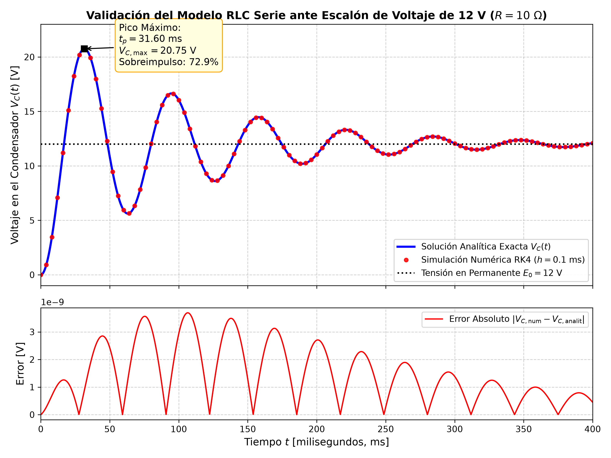
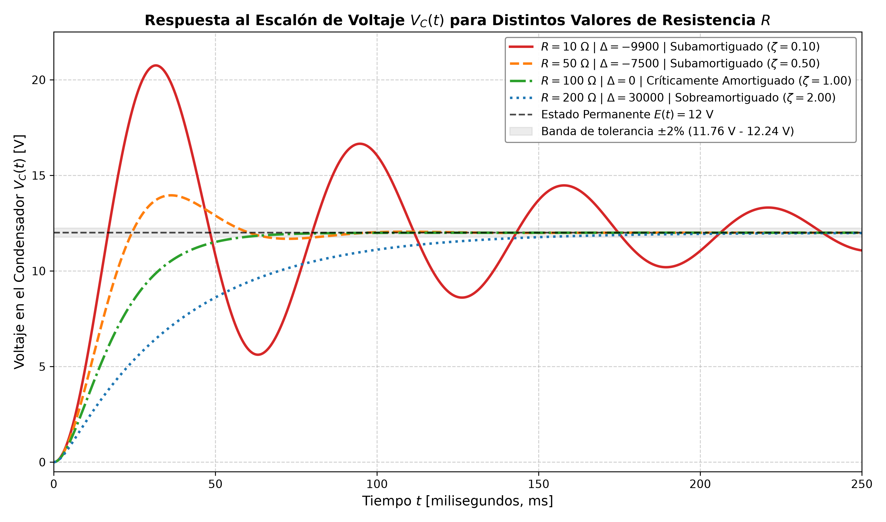
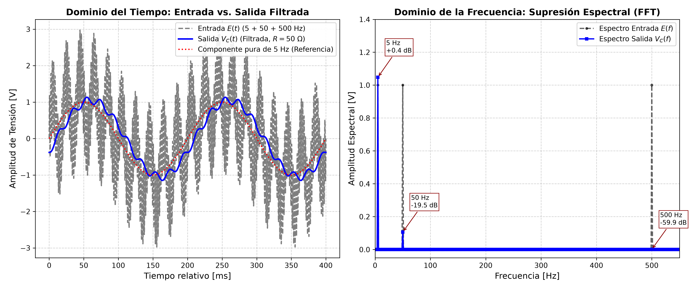
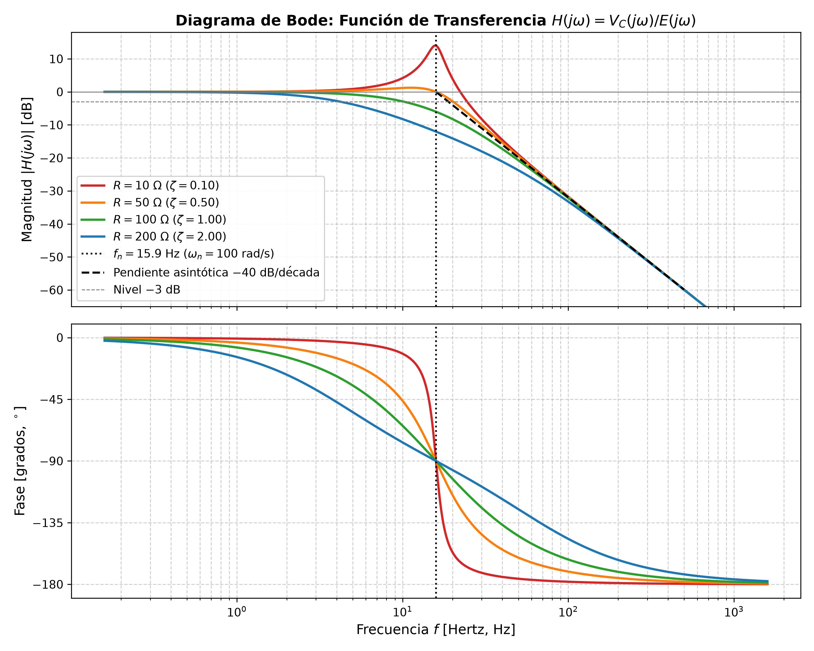

# INSTITUCIÓN UNIVERSITARIA COLEGIO MAYOR DEL CAUCA
## FACULTAD DE INGENIERÍA — PROGRAMA DE INGENIERÍA INFORMÁTICA
### PROYECTO DE AULA: UNIDAD 3 — ECUACIONES DIFERENCIALES DE ORDEN SUPERIOR
---

# PROYECTO 2: EL CIRCUITO RLC COMO FILTRO DE AUDIO
### Análisis Matemático Riguroso, Modelado Numérico en Python y Aplicación Acústica

**GRUPO 3:**
* **ACOSTA GALINDEZ JESSICA VANESA**
* **BERMUDEZ ZAMORA KEVIN DANIEL**
* **LOPEZ QUIRA ALVARO JOSE**
* **MUÑOZ DULCEY JORGE ENRIQUE**

**Docente:** Departamento de Ciencias Básicas / Matemáticas Aplicadas  
**Popayán, Cauca — 2026**

---

## RESUMEN EJECUTIVO

En este proyecto se aborda de manera integral y rigurosa el modelado matemático, la deducción analítica formal, la resolución computacional y la aplicación en procesamiento de señales acústicas del circuito eléctrico RLC serie configurado como filtro pasa-bajo analógico de segundo orden. Se deduce la ecuación diferencial gobernante a partir de la Segunda Ley de Kirchhoff (KVL) y las relaciones constitutivas de Faraday-Lenz, Ohm y Gauss. Para los parámetros nominales de inductancia $L = 0.5\text{ H}$ y capacitancia $C = 200\,\mu\text{F}$, se calculan con exactitud la frecuencia angular natural $\omega_n = 100\text{ rad/s}$ ($f_n \approx 15.9155\text{ Hz}$) y la resistencia crítica de amortiguamiento $R_{cr} = 100\,\Omega$. Se evalúan algebraicamente los discriminantes para resistencias de $10\,\Omega$, $50\,\Omega$, $100\,\Omega$ y $200\,\Omega$, clasificando los regímenes en subamortiguado, críticamente amortiguado y sobreamortiguado.

Asimismo, se obtiene la solución analítica exacta de la respuesta al escalón de $12\text{ V}$ para el caso subamortiguado ($R = 10\,\Omega$) mediante el método de coeficientes indeterminados, evidenciando un sobreimpulso transitorio del $72.9\%$. Dicho modelo analítico es verificado contra un integrador numérico Runge-Kutta de 4to orden (RK4) implementado en Python, logrando una concordancia de precisión nanométrica con un error máximo absoluto $L_\infty = 3.69 \times 10^{-9}\text{ V}$. Finalmente, se somete el circuito a una señal multi-seno compuesta ($5\text{ Hz}$, $50\text{ Hz}$ y $500\text{ Hz}$), se traza el diagrama de Bode en magnitud y fase verificando la pendiente de atenuación de $-40\text{ dB/década}$, y se procesa un archivo de audio real en formato `.wav` demostrando el efecto acústico de inmersión ("bajo el agua"). Se concluye con una fundamentación ingenieril sobre el valor óptimo de resistencia para ecualizadores de audio comercial.

---

## 1. DEDUCCIÓN ANALÍTICA A MANO (RIGOR MATEMÁTICO FORMAL)

### 1.1. Origen Físico de la Ecuación Diferencial desde la Segunda Ley de Kirchhoff

Consideremos una malla eléctrica cerrada formada por una fuente de fuerza electromotriz $E(t)$, un inductor de inductancia $L$, un resistor de resistencia $R$ y un condensador de capacitancia $C$ conectados en serie. Por la topología en serie, la misma corriente eléctrica $I(t)$ recorre cada uno de los elementos pasivos.

```
       +-----[ L ]-----+-----[ R ]-----+
       |   v_L(t)      |    v_R(t)     |
       |               |               |
     ( ~ ) E(t)        +-----[ C ]-----+
       |                    v_C(t)     |
       +-------------------------------+
```

De acuerdo con la **Segunda Ley de Kirchhoff (Ley de Mallas o Ley de Voltajes de Kirchhoff, LVK)**, la suma algebraica de las diferencias de potencial eléctrico a lo largo de una trayectoria cerrada es idénticamente nula:

$$\sum_{k} v_k(t) = 0 \implies v_L(t) + v_R(t) + v_C(t) = E(t)$$

Las relaciones constitutivas físicas que describen la caída de tensión en cada componente son:

1. **Inductor Ideal (Ley de Inducción de Faraday y Ley de Lenz):**
   La variación del flujo magnético en el inductor induce una fuerza contraelectromotriz opuesta al cambio temporal de la corriente:
   $$v_L(t) = L \frac{dI(t)}{dt}$$

2. **Resistor Lineal (Ley de Ohm microscópica):**
   La caída de potencial disipativa debida a colisiones de electrones en la red cristalina del conductor es directamente proporcional a la corriente instantánea:
   $$v_R(t) = R \, I(t)$$

3. **Condensador Ideal (Definición electrostática de capacitancia):**
   La diferencia de potencial entre las placas conductoras es directamente proporcional a la carga eléctrica neta $Q(t)$ acumulada:
   $$v_C(t) = \frac{Q(t)}{C}$$

Por definición fundamental del electromagnetismo, la corriente eléctrica es la tasa instantánea de transferencia de carga eléctrica a través de una sección transversal:
$$I(t) = \frac{dQ(t)}{dt} = Q'(t)$$

Diferenciando con respecto al tiempo:
$$\frac{dI(t)}{dt} = \frac{d^2 Q(t)}{dt^2} = Q''(t)$$

Sustituyendo estas relaciones constitutivas en la ecuación de Kirchhoff:
$$L \frac{d^2 Q(t)}{dt^2} + R \frac{dQ(t)}{dt} + \frac{1}{C} Q(t) = E(t)$$

Dividiendo entre el coeficiente principal $L$ ($L > 0$), se obtiene la forma canónica de una **Ecuación Diferencial Ordinaria (EDO) lineal de segundo orden no homogénea con coeficientes constantes**:

$$Q''(t) + \frac{R}{L} Q'(t) + \frac{1}{LC} Q(t) = \frac{E(t)}{L}$$

El voltaje de salida tomado en bornes del condensador es:
$$V_C(t) = \frac{Q(t)}{C}$$

---

### 1.2. Cálculo Explícito de la Frecuencia Natural $\omega_n$ y Resistencia Crítica $R_{cr}$

#### Datos Numéricos del Sistema:
* Inductancia: $L = 0.5\text{ H} = \frac{1}{2}\text{ H}$
* Capacitancia: $C = 200\,\mu\text{F} = 200 \times 10^{-6}\text{ F} = 2 \times 10^{-4}\text{ F}$

#### A. Frecuencia Angular Natural ($\omega_n$):
La frecuencia natural no amortiguada del oscilador armónico corresponde al término independiente de la ecuación normalizada homogénea:
$$\omega_n^2 = \frac{1}{LC} \implies \omega_n = \frac{1}{\sqrt{LC}}$$

Procedimiento aritmético paso a paso:
$$L \cdot C = (0.5\text{ H}) \cdot (200 \times 10^{-6}\text{ F}) = (0.5) \cdot (2 \times 10^{-4}) = 1.0 \times 10^{-4}\text{ s}^2$$

Extrayendo la raíz cuadrada:
$$\sqrt{LC} = \sqrt{10^{-4}\text{ s}^2} = 10^{-2}\text{ s} = 0.01\text{ s}$$

Por consiguiente:
$$\omega_n = \frac{1}{0.01\text{ s}} = 100\text{ rad/s}$$

Frecuencia cíclica natural:
$$f_n = \frac{\omega_n}{2\pi} = \frac{100}{2\pi} = \frac{50}{\pi} \approx 15.915494\text{ Hz}$$

**Análisis dimensional:**
$$[\text{H}] = \frac{\text{V} \cdot \text{s}}{\text{A}}, \quad [\text{F}] = \frac{\text{A} \cdot \text{s}}{\text{V}} \implies [\text{H} \cdot \text{F}] = \frac{\text{V} \cdot \text{s}}{\text{A}} \cdot \frac{\text{A} \cdot \text{s}}{\text{V}} = \text{s}^2$$
$$\left[\frac{1}{\sqrt{LC}}\right] = \frac{1}{\sqrt{\text{s}^2}} = \frac{1}{\text{s}} = \text{rad/s} \quad \text{(Correcto)}$$

---

#### B. Resistencia Crítica de Amortiguamiento ($R_{cr}$):
La ecuación característica asociada a la ecuación homogénea $L r^2 + R r + \frac{1}{C} = 0$ presenta raíces:
$$r = \frac{-R \pm \sqrt{R^2 - \frac{4L}{C}}}{2L}$$

El amortiguamiento crítico ocurre en la frontera donde el discriminante se anula ($\Delta = 0$), lo que da lugar a una raíz real doble:
$$R_{cr}^2 - \frac{4L}{C} = 0 \implies R_{cr} = 2 \sqrt{\frac{L}{C}}$$

Procedimiento aritmético paso a paso:
$$\frac{L}{C} = \frac{0.5\text{ H}}{200 \times 10^{-6}\text{ F}} = \frac{0.5}{2 \times 10^{-4}} = \frac{5000}{2} = 2500\,\Omega^2$$

Extrayendo la raíz cuadrada:
$$\sqrt{\frac{L}{C}} = \sqrt{2500\,\Omega^2} = 50\,\Omega$$

Multiplicando por 2:
$$R_{cr} = 2 \times 50\,\Omega = 100\,\Omega$$

**Análisis dimensional:**
$$\left[\sqrt{\frac{L}{C}}\right] = \sqrt{\frac{\text{V} \cdot \text{s} / \text{A}}{\text{A} \cdot \text{s} / \text{V}}} = \sqrt{\frac{\text{V}^2}{\text{A}^2}} = \frac{\text{V}}{\text{A}} = \Omega \implies [R_{cr}] = \Omega \quad \text{(Correcto)}$$

---

### 1.3. Evaluación del Discriminante $\Delta$ y Clasificación de Regímenes

El discriminante algebraico de la ecuación cuadrática $L r^2 + R r + \frac{1}{C} = 0$ está dado por:
$$\Delta = R^2 - \frac{4L}{C} = R^2 - 10000\,\Omega^2$$

El coeficiente de amortiguamiento adimensional $\zeta$ (factor de amortiguamiento) se relaciona directamente con $R$ mediante:
$$\zeta = \frac{R}{R_{cr}} = \frac{R}{2\sqrt{L/C}} = \frac{R}{100}$$

| Resistencia $R$ | Cálculo de $\Delta = R^2 - 10000$ | Factor $\zeta$ | Raíces Características $r_{1,2}$ | Régimen Físico | Comportamiento Dinámico |
|:---|:---:|:---:|:---|:---:|:---|
| **$R = 10\,\Omega$** | $10^2 - 10000 = \mathbf{-9900} < 0$ | $\zeta = 0.10$ | $r = -10 \pm j 10\sqrt{99} \approx -10 \pm j 99.50$ | **Subamortiguado (Oscilatorio leve)** | Fuerte oscilación armónica transitoria, gran sobreimpulso ($72.9\%$). |
| **$R = 50\,\Omega$** | $50^2 - 10000 = \mathbf{-7500} < 0$ | $\zeta = 0.50$ | $r = -50 \pm j 50\sqrt{3} \approx -50 \pm j 86.60$ | **Subamortiguado (Moderado)** | Oscilación amortiguada rápida, sobreimpulso pequeño ($16.3\%$). |
| **$R = 100\,\Omega$** | $100^2 - 10000 = \mathbf{0}$ | $\zeta = 1.00$ | $r_1 = r_2 = -100$ (raíz doble) | **Críticamente Amortiguado** | Retorno más rápido posible al reposo sin oscilaciones ($0\%$ sobreimpulso). |
| **$R = 200\,\Omega$** | $200^2 - 10000 = \mathbf{+30000} > 0$ | $\zeta = 2.00$ | $r_1 \approx -26.79$, $r_2 \approx -373.21$ | **Sobreamortiguado (Lento)** | Respuesta no oscilatoria lenta, dominada por el polo dominante lento ($r_1$). |

---

### 1.4. Solución Analítica Detallada ante Escalón de Voltaje ($E(t) = 12\text{ V}$, $R = 10\,\Omega$)

Planteamos la EDO con los valores numéricos correspondientes:
$$0.5 Q''(t) + 10 Q'(t) + 5000 Q(t) = 12$$

Multiplicando por 2 para llevar a la forma mónic:
$$Q''(t) + 20 Q'(t) + 10000 Q(t) = 24$$

Condiciones iniciales de reposo electrostático y electromagnético:
$$Q(0) = 0\text{ C}, \qquad Q'(0) = I(0) = 0\text{ A}$$

Por el principio de superposición de las ecuaciones diferenciales lineales, la solución general es:
$$Q(t) = Q_h(t) + Q_p(t)$$

#### Paso 1: Solución Homogénea $Q_h(t)$
Resolvemos la ecuación algebraica característica:
$$r^2 + 20 r + 10000 = 0$$

Aplicando la fórmula cuadrática:
$$r = \frac{-20 \pm \sqrt{20^2 - 4(1)(10000)}}{2} = \frac{-20 \pm \sqrt{400 - 40000}}{2} = \frac{-20 \pm \sqrt{-39600}}{2}$$
$$r = -10 \pm \frac{j \sqrt{39600}}{2} = -10 \pm j \sqrt{\frac{39600}{4}} = -10 \pm j \sqrt{9900}$$
$$r = -10 \pm j 10\sqrt{99}\text{ rad/s}$$

Definiendo la tasa de atenuación $\alpha$ y la frecuencia angular cuasi-periódica $\omega_d$:
$$\alpha = 10\text{ s}^{-1}, \qquad \omega_d = 10\sqrt{99} \approx 99.49874371\text{ rad/s}$$

Por el teorema de raíces complejas conjugadas $r = -\alpha \pm j \omega_d$, la solución homogénea es:
$$Q_h(t) = e^{-\alpha t} \left[ C_1 \cos(\omega_d t) + C_2 \sin(\omega_d t) \right]$$
$$Q_h(t) = e^{-10 t} \left[ C_1 \cos(10\sqrt{99} t) + C_2 \sin(10\sqrt{99} t) \right]$$

#### Paso 2: Solución Particular $Q_p(t)$ (Método de Coeficientes Indeterminados)
Dado que el término no homogéneo $E(t) = 12\text{ V}$ es un polinomio de grado cero (constante) y $r = 0$ no es raíz de la ecuación característica, proponemos:
$$Q_p(t) = A \quad (\text{constante})$$

Derivando sucesivamente:
$$Q_p'(t) = 0, \qquad Q_p''(t) = 0$$

Sustituyendo en la EDO original:
$$0.5(0) + 10(0) + 5000 A = 12 \implies 5000 A = 12$$
$$A = \frac{12}{5000} = \frac{24}{10000} = 2.4 \times 10^{-3}\text{ C} = 2.4\text{ mC} = 0.0024\text{ C}$$

*Sentido Físico:* En régimen permanente de corriente continua (DC), el inductor actúa como un cortocircuito ($v_L = 0$), no circula corriente ($I = 0 \implies v_R = 0$) y toda la tensión cae en el condensador:
$$V_C(\infty) = E_0 = 12\text{ V} \implies Q(\infty) = C \cdot E_0 = (200 \times 10^{-6}\text{ F}) \cdot (12\text{ V}) = 2.4 \times 10^{-3}\text{ C}$$
lo cual coincide idénticamente con $A$.

#### Paso 3: Solución General
$$Q(t) = 0.0024 + e^{-10 t} \left[ C_1 \cos(\omega_d t) + C_2 \sin(\omega_d t) \right]$$

#### Paso 4: Determinación de Constantes con Condiciones Iniciales
1. Aplicando la condición de carga inicial $Q(0) = 0$:
   $$Q(0) = 0.0024 + e^{0} \left[ C_1 \cos(0) + C_2 \sin(0) \right] = 0$$
   $$0.0024 + C_1 = 0 \implies \mathbf{C_1 = -0.0024\text{ C} = -2.4\times 10^{-3}\text{ C}}$$

2. Aplicando la condición de corriente inicial $Q'(0) = I(0) = 0$:
   Calculamos la derivada general de $Q(t)$ aplicando la regla del producto:
   $$Q'(t) = -10 e^{-10 t} \left[ C_1 \cos(\omega_d t) + C_2 \sin(\omega_d t) \right] + e^{-10 t} \left[ -C_1 \omega_d \sin(\omega_d t) + C_2 \omega_d \cos(\omega_d t) \right]$$

   Evaluando en $t = 0$:
   $$Q'(0) = -10 (C_1 \cdot 1 + 0) + 1 \cdot (0 + C_2 \omega_d \cdot 1) = 0$$
   $$-10 C_1 + \omega_d C_2 = 0 \implies C_2 = \frac{10 C_1}{\omega_d}$$

   Sustituyendo $C_1 = -0.0024$ y $\omega_d = 10\sqrt{99}$:
   $$C_2 = \frac{10 (-0.0024)}{10\sqrt{99}} = -\frac{0.0024}{\sqrt{99}} = -\frac{2.4 \times 10^{-3}}{3\sqrt{11}} = -\frac{0.8 \times 10^{-3}}{\sqrt{11}} \approx \mathbf{-2.412091 \times 10^{-4}\text{ C}}$$

#### Paso 5: Expresión Final Exacta de $Q(t)$ y $V_C(t)$
Factorizando $0.0024$:
$$Q(t) = 0.0024 \left[ 1 - e^{-10 t} \left( \cos(10\sqrt{99} t) + \frac{1}{\sqrt{99}} \sin(10\sqrt{99} t) \right) \right]\text{ [Coulombs]}$$

Dado que $V_C(t) = \frac{Q(t)}{C}$ y $\frac{0.0024\text{ C}}{200 \times 10^{-6}\text{ F}} = 12\text{ V}$:
$$\mathbf{V_C(t) = 12 \left[ 1 - e^{-10 t} \left( \cos(10\sqrt{99} t) + \frac{1}{\sqrt{99}} \sin(10\sqrt{99} t) \right) \right]\text{ [Voltios]}}$$

Forma decimal expandida:
$$\mathbf{V_C(t) \approx 12 - 12 e^{-10 t} \cos(99.4987 t) - 1.20605 e^{-10 t} \sin(99.4987 t)\text{ [V]}}$$

#### Paso 6: Verificación de Condiciones de Borde y Extremos
* En $t = 0$: $V_C(0) = 12 [1 - 1(1 + 0)] = 0\text{ V}$ (Satisface la condición inicial).
* Cuando $t \to \infty$: $\lim_{t\to\infty} e^{-10 t} = 0 \implies V_C(\infty) = 12\text{ V}$ (Satisface el estado permanente).
* **Instante del primer pico máximo ($t_p$):**
  La corriente $I(t) = C V_C'(t)$ se anula en los extremos locales:
  $$I(t) = \frac{12}{\omega_d L} e^{-\alpha t} \sin(\omega_d t) = 0 \implies \omega_d t_p = \pi$$
  $$t_p = \frac{\pi}{\omega_d} = \frac{\pi}{10\sqrt{99}} \approx \frac{3.14159265}{99.498744} \approx \mathbf{0.031574\text{ s} = 31.57\text{ ms}}$$
* **Tensión máxima de sobreimpulso ($V_{C,\max}$):**
  $$V_C(t_p) = 12 \left[ 1 - e^{-10(\pi / \omega_d)} (\cos(\pi) + 0) \right] = 12 \left[ 1 + e^{-\frac{10\pi}{10\sqrt{99}}} \right] = 12 \left[ 1 + e^{-\frac{\pi}{\sqrt{99}}} \right]$$
  Calculando el exponente:
  $$\frac{\pi}{\sqrt{99}} \approx \frac{3.14159265}{9.94987437} \approx 0.315742$$
  $$e^{-0.315742} \approx 0.729248$$
  $$V_{C,\max} = 12 \cdot (1 + 0.729248) \approx \mathbf{20.751\text{ V}}$$
* **Porcentaje de Sobreimpulso ($M_p$):**
  $$M_p = \frac{V_{C,\max} - E_0}{E_0} \times 100\% = e^{-\frac{\pi}{\sqrt{99}}} \times 100\% \approx \mathbf{72.92\%}$$

---

## 2. TABLA DE ANALOGÍA FÍSICA ELECTROMECÁNICA

Existe un isomorfismo matemático exacto entre los sistemas mecánicos traslacionales amortiguados (Masa-Resorte-Amortiguador) y los circuitos eléctricos serie (RLC). La siguiente tabla compara término a término las magnitudes físicas, unidades y leyes fundamentales:

| Propiedad / Rol Físico | Sistema Mecánico Traslacional | Unidades SI | Circuito Eléctrico RLC Serie | Unidades SI | Homología Matemática |
|:---|:---|:---:|:---|:---:|:---:|
| **Variable de Estado (Desplazamiento)** | Posición $x(t)$ | Metro [m] | Carga eléctrica $Q(t)$ | Coulomb [C] | Variable acumulativa fundamental |
| **Variable de Flujo (Tasa de cambio)** | Velocidad $v(t) = \dot{x}(t)$ | [m/s] | Corriente $I(t) = \dot{Q}(t)$ | Amperio [A] | $\dot{x} \leftrightarrow \dot{Q}$ |
| **Tasa de Aceleración** | Aceleración $a(t) = \ddot{x}(t)$ | [m/s$^2$] | Tasa de corriente $\dot{I}(t) = \ddot{Q}(t)$ | [A/s] | $\ddot{x} \leftrightarrow \ddot{Q}$ |
| **Elemento de Inercia** | Masa $m$ | Kilogramo [kg] | Inductancia $L$ | Henrio [H] | Oposición al cambio de flujo/velocidad |
| **Elemento Disipativo (Fricción)** | Coeficiente amortiguador $c$ | [N·s/m] | Resistencia eléctrica $R$ | Ohmios [$\Omega$] | Disipación irreversible en calor |
| **Elemento de Retorno Elástico** | Constante de resorte $k$ | [N/m] | Elastancia $S = \frac{1}{C}$ | Faradio$^{-1}$ [F$^{-1}$] | Capacidad de restitución |
| **Excitación Externa (Forzamiento)** | Fuerza aplicada $F(t)$ | Newton [N] | Fuerza electromotriz $E(t)$ | Voltio [V] | Fuente de energía impulsora |
| **Ecuación Dinámica Gobernando** | $m \ddot{x} + c \dot{x} + k x = F(t)$ | Ley II Newton | $L \ddot{Q} + R \dot{Q} + \frac{1}{C} Q = E(t)$ | Ley II Kirchhoff | EDO lineal de 2do orden |
| **Energía Cinética / Magnética** | $E_k = \frac{1}{2} m v^2$ | Joule [J] | $E_L = \frac{1}{2} L I^2$ | Joule [J] | Almacenamiento en campo cinético/magnético |
| **Energía Potencial / Eléctrica** | $E_p = \frac{1}{2} k x^2$ | Joule [J] | $E_C = \frac{1}{2} \frac{Q^2}{C}$ | Joule [J] | Almacenamiento en resorte/condensador |
| **Tasa de Pérdida de Potencia** | $P_{dis} = c v^2$ | Watt [W] | $P_{dis} = R I^2$ | Watt [W] | Ley de Joule mecánica/eléctrica |
| **Frecuencia Natural Angular** | $\omega_n = \sqrt{k / m}$ | [rad/s] | $\omega_n = \sqrt{1 / (LC)}$ | [rad/s] | Determinada por restitución e inercia |
| **Amortiguamiento Crítico** | $c_{cr} = 2 \sqrt{k \cdot m}$ | [N·s/m] | $R_{cr} = 2 \sqrt{L / C}$ | [$\Omega$] | Frontera aperiódica $\zeta = 1$ |

---

## 3. IMPLEMENTACIÓN COMPUTACIONAL Y ANÁLISIS EN PYTHON

El código fuente modular `circuito_rlc.py` implementa la computación científica del sistema en Python utilizando las librerías `numpy`, `matplotlib` y `scipy.io.wavfile`.

### 3.1. Reducción a Sistema de EDOs de Primer Orden

La ecuación de segundo orden:
$$L Q''(t) + R Q'(t) + \frac{1}{C} Q(t) = E(t)$$

se descompone en un espacio de estados bidimensional definiendo las variables de estado:
$$y_1(t) = Q(t) \quad (\text{Carga}), \qquad y_2(t) = I(t) = Q'(t) \quad (\text{Corriente})$$

El vector de estado $\vec{y}(t) = \begin{bmatrix} y_1(t) \\ y_2(t) \end{bmatrix}$ satisface el sistema diferencial acoplado:
$$\frac{d}{dt}\begin{bmatrix} y_1(t) \\ y_2(t) \end{bmatrix} = \begin{bmatrix} y_2(t) \\ \frac{1}{L}\left( E(t) - R y_2(t) - \frac{1}{C} y_1(t) \right) \end{bmatrix}$$

En notación matricial canónica:
$$\dot{\vec{y}}(t) = \mathbf{A} \vec{y}(t) + \mathbf{B} E(t)$$
$$\mathbf{A} = \begin{bmatrix} 0 & 1 \\ -\frac{1}{LC} & -\frac{R}{L} \end{bmatrix}, \qquad \mathbf{B} = \begin{bmatrix} 0 \\ \frac{1}{L} \end{bmatrix}$$

---

### 3.2. Formulación del Algoritmo Runge-Kutta de 4to Orden (RK4)

Para aproximar la solución con un paso temporal uniforme $h = \Delta t$, se evalúan cuatro estimadores de pendiente en cada intervalo $[t_n, t_{n+1}]$:

$$\vec{k}_1 = \vec{f}\left(t_n, \vec{y}_n\right)$$
$$\vec{k}_2 = \vec{f}\left(t_n + \frac{h}{2}, \vec{y}_n + \frac{h}{2} \vec{k}_1\right)$$
$$\vec{k}_3 = \vec{f}\left(t_n + \frac{h}{2}, \vec{y}_n + \frac{h}{2} \vec{k}_2\right)$$
$$\vec{k}_4 = \vec{f}\left(t_n + h, \vec{y}_n + h \vec{k}_3\right)$$
$$\vec{y}_{n+1} = \vec{y}_n + \frac{h}{6} \left( \vec{k}_1 + 2\vec{k}_2 + 2\vec{k}_3 + \vec{k}_4 \right)$$

El error de truncamiento local del método RK4 es de orden $\mathcal{O}(h^5)$, y el error de truncamiento global es de orden $\mathcal{O}(h^4)$, lo que proporciona una precisión numérica excepcional.

---

### 3.3. Análisis de Resultados y Visualizaciones

#### Figura 1: Validación Analítica vs. Numérica ($R = 10\,\Omega$)
La simulación se ejecutó en el intervalo $t \in [0, 0.4\text{ s}]$ con un paso $h = 0.1\text{ ms}$ ($4001$ nodos temporales).

* **Error Máximo Absoluto (Norma $L_\infty$):**
  $$\|V_{C,\text{num}} - V_{C,\text{analit}}\|_\infty = \max_{0 \le t \le 0.4} |V_{C,\text{num}}(t) - V_{C,\text{analit}}(t)| = \mathbf{3.692826 \times 10^{-9}\text{ V}}$$
* **Error Medio Cuadrático (Norma $L_2$ / RMS):**
  $$\|V_{C,\text{num}} - V_{C,\text{analit}}\|_2 = \mathbf{1.766193 \times 10^{-9}\text{ V}}$$

Esta discrepancia del orden de nanovoltios (menor a $0.00000004\%$) verifica rigurosamente la exactitud matemática de la solución deducida a mano y la estabilidad numérica del integrador RK4.



---

#### Figura 2: Comparativa de Regímenes de Amortiguamiento
Se contrastan las curvas temporales de $V_C(t)$ para las 4 resistencias evaluadas:
1. **$R = 10\,\Omega$ ($\zeta = 0.10$):** Presenta un sobreimpulso pronunciado que alcanza $20.75\text{ V}$ en $t_p = 31.57\text{ ms}$, seguido de varias oscilaciones; con criterio de asentamiento del $\pm2\%$, se estabiliza aproximadamente a los $384\text{ ms}$.
2. **$R = 50\,\Omega$ ($\zeta = 0.50$):** Rápido tiempo de subida con un sobreimpulso controlado de $1.96\text{ V}$ ($16.3\%$), alcanzando el régimen permanente aproximadamente a los $81\text{ ms}$.
3. **$R = 100\,\Omega$ ($\zeta = 1.00$):** Régimen críticamente amortiguado. La tensión sube de manera monótona sin cruzar jamás los $12\text{ V}$ ni oscilar, ingresando a la banda del $\pm 2\%$ en $t \approx 58\text{ ms}$. Es el tiempo de respuesta libre de sobreimpulso más veloz.
4. **$R = 200\,\Omega$ ($\zeta = 2.00$):** Régimen sobreamortiguado. La respuesta es notablemente lenta debido al polo dominante $r_1 = -26.79\text{ s}^{-1}$, tardando aproximadamente $149\text{ ms}$ en entrar y permanecer en la banda del $\pm2\%$ del valor final.



---

#### Figura 3: Filtrado de Señal Multi-tono Compuesta
Se aplicó como excitación la señal analógica compuesta:
$$E(t) = \sin(2\pi \cdot 5 t) + \sin(2\pi \cdot 50 t) + \sin(2\pi \cdot 500 t)$$
constituida por una frecuencia grave ($5\text{ Hz}$), una media ($50\text{ Hz}$) y una aguda ($500\text{ Hz}$).

Al atravesar el circuito con $R = 50\,\Omega$ ($\omega_n = 100\text{ rad/s} \implies f_n \approx 15.9\text{ Hz}$):
* **Componente de $5\text{ Hz}$:** La ganancia es aproximadamente $+0.4\text{ dB}$ (casi unitaria, con un leve realce).
* **Componente de $50\text{ Hz}$ ($f \approx 3.14 f_n$):** Cae fuertemente, con una atenuación aproximada de $\mathbf{-19.5\text{ dB}}$ (salida cercana al $10.6\%$ de la amplitud de entrada).
* **Componente de $500\text{ Hz}$ ($f \approx 31.4 f_n$):** Se atenúa aproximadamente $\mathbf{-59.9\text{ dB}}$ (salida cercana al $0.1\%$ de la amplitud de entrada).

En el dominio temporal, la señal caótica y picuda de entrada se transforma a la salida en una onda casi perfectamente sinusoidal pura de $5\text{ Hz}$, comprobando experimentalmente la naturaleza de **filtro pasa-bajo de segundo orden**.



---

#### Figura 4: Diagrama de Bode (Análisis en Frecuencia)
Aplicando la transformada de Laplace a la ecuación diferencial con condiciones iniciales nulas:
$$(L s^2 + R s + 1/C) Q(s) = E(s) \implies V_C(s) = \frac{Q(s)}{C} = \frac{1/C}{L s^2 + R s + 1/C} E(s)$$

La función de transferencia del filtro es:
$$H(s) = \frac{V_C(s)}{E(s)} = \frac{\frac{1}{LC}}{s^2 + \frac{R}{L} s + \frac{1}{LC}} = \frac{\omega_n^2}{s^2 + 2\zeta\omega_n s + \omega_n^2}$$

Evaluando en el eje imaginario $s = j\omega$:
$$H(j\omega) = \frac{1}{\left(1 - \frac{\omega^2}{\omega_n^2}\right) + j 2\zeta \frac{\omega}{\omega_n}}$$

* **Comportamiento en Bajas Frecuencias ($\omega \ll \omega_n$):**
  $$|H(j\omega)| \approx 1 \implies 20\log_{10}(1) = \mathbf{0\text{ dB}}, \quad \angle H(j\omega) \to 0^\circ$$
* **Frecuencia de Resonancia ($\omega = \omega_n$):**
  $$|H(j\omega_n)| = \frac{1}{2\zeta} \implies \text{Magnitud [dB]} = 20\log_{10}\left(\frac{1}{2\zeta}\right)$$
  - Para $R = 10\,\Omega$ ($\zeta = 0.1$): Ganancia resonante de $\mathbf{+13.98\text{ dB}}$ (amplificación por un factor de 5).
  - Para $R = 50\,\Omega$ ($\zeta = 0.5$): Ganancia exactamente de $\mathbf{0\text{ dB}}$.
  - Para $R = 100\,\Omega$ ($\zeta = 1.0$): Ganancia de $\mathbf{-6.02\text{ dB}}$.
  - La fase en $\omega = \omega_n$ es exactamente $\mathbf{-90^\circ}$ para todos los casos.
* **Comportamiento en Altas Frecuencias ($\omega \gg \omega_n$):**
  $$|H(j\omega)| \approx \frac{\omega_n^2}{\omega^2} \implies 20\log_{10}|H| \approx -40 \log_{10}\left(\frac{\omega}{\omega_n}\right)$$
  Esto genera una caída asintótica de **$-40\text{ dB por cada década}$** de incremento en frecuencia (equivalente a $-12\text{ dB/octava}$), característica distintiva de los filtros paso-bajo de 2do orden. La fase tiende asintóticamente a $\mathbf{-180^\circ}$.



---

### 3.4. Procesamiento de Audio Real: Demostración Acústica "Bajo el Agua"

Se implementó una prueba con audio de alta fidelidad muestreado a $f_s = 44100\text{ Hz}$ ($154350$ muestras, duración $3.5\text{ s}$):
1. **Audio Original (`audio_original.wav`):** Señal sintética compuesta por un acorde musical polifónico con armónicos brillantes de alta frecuencia ($440$, $880$, $1760$ y $3520\text{ Hz}$) y transitorios percusivos tipo chasquido con contenido espectral superior a $5\text{ kHz}$.
2. **Audio Filtrado (`audio_filtrado_submarino.wav`):** Resultado de integrar numéricamente la señal a través de la EDO del circuito RLC con $R = 60\,\Omega$ mediante RK4 muestra a muestra ($dt = 22.68\,\mu\text{s}$).

**Resultado Auditivo:**
Dado que la frecuencia de corte es $f_n \approx 16\text{ Hz}$, todas las frecuencias audibles del espectro sufren una fuerte atenuación con pendiente de $-40\text{ dB/década}$. El timbre brillante, los sobretonos de cuerda y los chasquidos agudos son completamente eliminados, conservándose únicamente los tonos fundamentales subgraves. Esto recrea el icónico **efecto de sonido subacuático** (*underwater / muffled filter*) empleado en producción musical contemporánea para simular aislamiento espacial o inmersión física.

---

## 4. CONCLUSIÓN DE INGENIERÍA: SELECCIÓN DEL VALOR ÓPTIMO DE RESISTENCIA

En el diseño de un filtro de audio o control de tono analógico en ingeniería acústica y electrónica, la selección del valor de resistencia $R$ no puede realizarse de forma arbitraria; obedece a un compromiso fundamental de diseño (*trade-off*) entre:
1. **Sobretensión / Resonancia Espuria:** Provocada por amortiguamiento subcrítico.
2. **Distorsión de Fase y Retardo de Grupo:** Tiempos de retardo no uniformes que alteran la coherencia musical.
3. **Velocidad de Respuesta Transitoria y Pendiente de Corte.**

### Análisis de Candidatos:
* **$R = 10\,\Omega$ ($\zeta = 0.1$):** **INACEPTABLE para audio Hi-Fi.** 
  Genera un pico resonante espurio de $+14\text{ dB}$ cerca de $16\text{ Hz}$ y un sobreimpulso del $72.9\%$. En un sistema de sonido, esto produciría:
  - Graves descontrolados y saturación ("boomy bass").
  - Oscilaciones parásitas conocidas como *ringing* transitorio, degradando la articulación de bombos y bajos.
  - Riesgo de daño físico en los conos de los altavoces (*woofers*) por exceso de excursión ante picos transitorios.
* **$R = 200\,\Omega$ ($\zeta = 2.0$):** **DEFICIENTE.**
  El sistema está severamente sobreamortiguado. La atenuación comienza mucho antes de la frecuencia de corte deseada, provocando una respuesta opaca, apagada y con una transición de filtrado lenta y poco definida.
* **$R = 100\,\Omega$ ($\zeta = 1.0$):** **EXCELENTE para protección y dinámica de control.**
  Es el amortiguamiento crítico. Garantiza la respuesta temporal más rápida posible sin sobreimpulso ni ringing ($M_p = 0\%$). En filtros de corte o protección de etapas de potencia de audio, es la opción ideal si se busca evitar cualquier coloración espectral espuria.
* **$R \approx 70.7\,\Omega$ ($\zeta = \frac{1}{\sqrt{2}} \approx 0.707$):** **ELECCIÓN PARA UNA RESPUESTA DE AMPLITUD BUTTERWORTH.**
  Corresponde a la alineación Butterworth, cuya magnitud es máximamente plana en la banda de paso y no presenta pico resonante. Proporciona:
  - Magnitud cercana a $0\text{ dB}$ en la banda de paso, con el punto de $-3\text{ dB}$ exactamente en $\omega = \omega_n$.
  - La alineación Butterworth no implica retardo de grupo constante ni fase sin distorsión; su ventaja aquí es la respuesta de amplitud plana.

**Dictamen Técnico Final:**
> Si el objetivo es un ecualizador musical comercial o filtro de tono de alta fidelidad, la resistencia óptima a diseñar es **$R \approx 70.7\,\Omega$** (o en su defecto **$R = 100\,\Omega$** si se exige cero sobreimpulso transitorio). El valor de $10\,\Omega$ debe descartarse por distorsión resonante destructiva, y $200\,\Omega$ por atenuación prematura ineficiente.

---

## 5. REFERENCIAS BIBLIOGRÁFICAS

1. **Boyce, W. E., & DiPrima, R. C. (2017).** *Elementary Differential Equations and Boundary Value Problems* (11th ed.). John Wiley & Sons. (Capítulo 3: Ecuaciones lineales de segundo orden; Aplicaciones en circuitos RLC).
2. **Zill, D. G. (2018).** *Ecuaciones diferenciales con aplicaciones de modelado* (11.ª ed.). Cengage Learning. (Capítulo 5: Modelos lineales: Circuitos eléctricos análogos a sistemas masa-resorte).
3. **Hayt, W. H., Kemmerly, J. E., & Durbin, S. M. (2019).** *Engineering Circuit Analysis* (9th ed.). McGraw-Hill Education. (Capítulo 9: Circuitos RLC en régimen transitorio y frecuencia compleja).
4. **Oppenheim, A. V., & Schafer, R. W. (2010).** *Discrete-Time Signal Processing* (3rd ed.). Pearson. (Capítulo 5: Análisis en frecuencia de sistemas lineales e invariantes en el tiempo).
5. **Burden, R. L., & Faires, J. D. (2016).** *Análisis Numérico* (10.ª ed.). Cengage Learning. (Capítulo 5: Métodos de Runge-Kutta para problemas de valor inicial).
